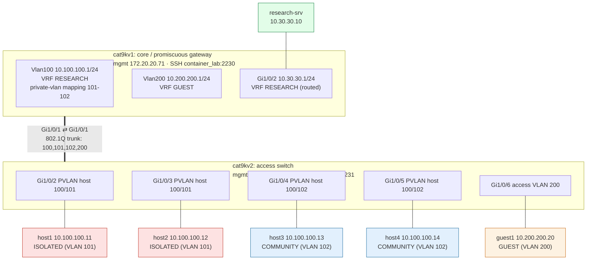
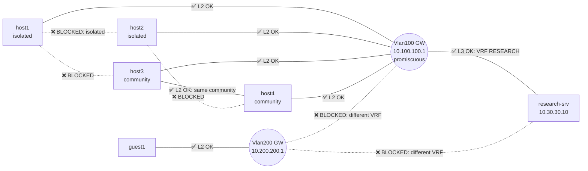
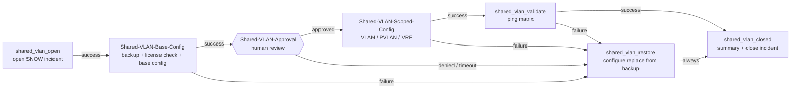

# Shared VLAN Lab — Private VLANs + VRF-Lite + 802.1Q on Catalyst 9000v (IOS-XE)

This lab shows how a single "shared VLAN" (one IP subnet) can be used by many endpoints that
are still **isolated from each other**, which is a common pattern for high-containment labs and OT
networks. It combines:

| Technology | Role in this lab |
|---|---|
| **Private VLANs (PVLAN)** | One shared subnet (10.100.100.0/24) split into *isolated* and *community* secondary VLANs, with a single *promiscuous* gateway |
| **VRF-Lite** | Separate routing tables on the same switch: `RESEARCH` (secure) and `GUEST` (vendor/guest), no route leaking |
| **802.1Q trunking** | One link between the switches carries the primary, secondary and guest VLANs |

The lab runs in **containerlab** on a remote host and is configured from **Ansible Automation
Platform (AAP)** with the playbooks and roles in this folder.

> 🔀 **NX-OS variant:** a self-contained Nexus 9000v version of this lab, with its own topology, roles
> and AAP objects (all named `…n9kv…`), lives in [`shared_vlans_n9kv/`](shared_vlans_n9kv/README.md).

> ℹ️ **Platform:** this lab runs on **Catalyst 9000v (IOS-XE 17.12, `network-advantage`)**. It was
> first built on Nexus 9000v, but n9kv's emulated data plane doesn't forward private-VLAN traffic
> (see [section 9](#9-platform-history-why-catalyst-9000v)). On cat9kv, **all 7 segmentation checks
> pass** (verified 2026-11-24).

---

## 1. Topology

### Physical / logical diagram



<details>
<summary>Plain-text version</summary>

```
 research-srv 10.30.30.10
      | eth1
 [Gi1/0/2 routed, VRF RESEARCH 10.30.30.1]
 cat9kv1  core / promiscuous gateway        172.20.20.71   ssh container_lab:2230
   Vlan100 10.100.100.1  VRF RESEARCH  (private-vlan mapping 101-102)
   Vlan200 10.200.200.1  VRF GUEST
 Gi1/0/1
   ||  802.1Q trunk  allowed 100,101,102,200
 Gi1/0/1
 cat9kv2  access                            172.20.20.72   ssh container_lab:2231
   Gi1/0/2  host1   10.100.100.11  PVLAN host 100/101  ISOLATED
   Gi1/0/3  host2   10.100.100.12  PVLAN host 100/101  ISOLATED
   Gi1/0/4  host3   10.100.100.13  PVLAN host 100/102  COMMUNITY
   Gi1/0/5  host4   10.100.100.14  PVLAN host 100/102  COMMUNITY
   Gi1/0/6  guest1  10.200.200.20  access VLAN 200     GUEST
```
</details>

### Addressing and segmentation

| VLAN / VRF | Type | Subnet | Gateway | Members |
|---|---|---|---|---|
| 100 `SHARED_PRIMARY` | PVLAN primary | 10.100.100.0/24 | `Vlan100` .1 on cat9kv1 | (carries gateway → hosts traffic) |
| 101 `OT_ISOLATED` | PVLAN isolated | same /24 | via Vlan100 mapping | host1, host2 |
| 102 `LAB_COMMUNITY` | PVLAN community | same /24 | via Vlan100 mapping | host3, host4 |
| 200 `GUEST` | normal VLAN | 10.200.200.0/24 | `Vlan200` .1 on cat9kv1 | guest1 |
| VRF `RESEARCH` | VRF-Lite | 10.100.100.0/24, 10.30.30.0/24 | cat9kv1 | Vlan100, Gi1/0/2 (research-srv) |
| VRF `GUEST` | VRF-Lite | 10.200.200.0/24 | cat9kv1 | Vlan200 |

Containerlab maps `ethN` on a cat9kv to `GigabitEthernet1/0/N`; the management port is
`GigabitEthernet0/0` in VRF `Mgmt-vrf`. Linux endpoints use `eth1` for data and
`eth0` for containerlab management (172.20.20.73–78).

---

## 2. Who can talk to whom

### Traffic flow



### Reachability matrix

| From ↓ / To → | host1 | host2 | host3 | host4 | GW .1 | research-srv | guest1 |
|---|:-:|:-:|:-:|:-:|:-:|:-:|:-:|
| **host1** (isolated) | — | ❌ | ❌ | ❌ | ✅ | ✅ | ❌ |
| **host2** (isolated) | ❌ | — | ❌ | ❌ | ✅ | ✅ | ❌ |
| **host3** (community) | ❌ | ❌ | — | ✅ | ✅ | ✅ | ❌ |
| **host4** (community) | ❌ | ❌ | ✅ | — | ✅ | ✅ | ❌ |
| **research-srv** | ✅ | ✅ | ✅ | ✅ | ✅ | — | ❌ |
| **guest1** (VRF GUEST) | ❌ | ❌ | ❌ | ❌ | ❌ | ❌ | — (✅ to 10.200.200.1) |

Why:
- **Isolated ports (VLAN 101)** can forward only to the promiscuous gateway. host1 and host2 share a
  subnet but cannot even ARP for each other, which stops lateral movement from a compromised sensor.
- **Community ports (VLAN 102)** can reach each other and the gateway, but not isolated ports or other
  communities.
- **The promiscuous gateway** (`interface Vlan100` + `private-vlan mapping 101-102`) receives from
  all secondaries and replies on primary VLAN 100, so every PVLAN host can route off-subnet
  (e.g. to research-srv) inside **VRF RESEARCH**.
- **VRF-Lite** puts the guest SVI in **VRF GUEST** with its own routing table and no route leaking,
  so guest1 cannot reach anything in RESEARCH even though it's on the same physical switch and trunk.
- **The 802.1Q trunk** carries VLANs 100/101/102/200 between switches. Both switches carry the PVLAN
  definitions, so isolation is enforced across the trunk.

---

## 3. Files

```
shared_vlans/
├── shared_vlan.clab.yml        # containerlab topology (deploy on the remote clab host)
├── setup.yml                   # AAP controller-as-code (hosts, group, credential, templates, workflow)
├── inventory.yml               # example CLI inventory (same layout as AAP)
├── snow_open.yml               # playbook: open ServiceNow incident (workflow step 1)
├── base_config.yml             # playbook: initial cat9kv config (ip routing, VTP, lldp, ...)
├── scoped_config.yml           # playbook: VLANs, trunk, PVLAN, VRF-Lite
├── validate.yml                # playbook: endpoint ping matrix on the containerlab host
├── restore.yml                 # playbook: roll switches back to the base_config backup
├── snow_close.yml              # playbook: add per-node summary to the incident, close it
├── group_vars/shared_vlan.yml  # settings shared by both switches
├── host_vars/cat9kv1.yml         # core / gateway switch data
├── host_vars/cat9kv2.yml         # access switch data
├── shared_vlans_n9kv/          # self-contained Nexus 9000v (NX-OS) variant of this lab
├── backups/                    # <host>.cfg = rollback point (base pre_task), <host>_scoped.cfg = post-change
└── roles/
    ├── ios_base/              # hostname, global lines, mgmt route, banner, interfaces
    ├── ios_trunk/             # regular VLANs, 802.1Q trunks, access ports
    ├── ios_pvlan/             # PVLAN domain, host ports, promiscuous mapping
    ├── ios_vrf_lite/          # VRF definitions, SVIs / routed ports in VRFs, static routes
    ├── git_backup/             # back up running config and push to Gitea (master)
    ├── shared_vlan_validate/   # docker exec ping checks, PASS/FAIL report, artifact
    └── ios_restore/           # copy backup to flash + configure replace
```

---

## 4. AAP

AAP is remote from the containerlab host. Each switch is reached through the containerlab host's
port forwarding: **cat9kv1 → `container_lab:2230`**, **cat9kv2 → `container_lab:2231`**.

### Objects (created by `setup.yml`)

| Object | Name | Details |
|---|---|---|
| Hosts | `cat9kv1`, `cat9kv2` | In **Workshop Inventory**. `ansible_host: '{{ container_lab }}'`, `ansible_port` 2230 / 2231, `cisco.ios.ios` over `network_cli` |
| Inventory var | `container_lab` | Defined on Workshop Inventory: **10.10.10.10** (containerlab host) |
| Group | `shared_vlan` | cat9kv1 + cat9kv2; the playbooks target this group (`_group` overrides) |
| Credential | `Shared VLAN cat9kv Credential` | Machine credential for the switches (user `admin`, password set in `setup.yml`) |
| Credential | `Gitea Credential` | Existing; injects `username`, `password`, `email` used by `git_backup` |
| Credential | `snow_demo` | Existing; injects `SN_HOST`, `SN_USERNAME`, `SN_PASSWORD` for ServiceNow |
| Credential | `azure` | Existing; SSH key for `azureuser` on the containerlab host |
| Job template | `shared_vlan_open` | `shared_vlans/snow_open.yml` (localhost), `snow_demo` |
| Job template | `Shared-VLAN-Base-Config` | `shared_vlans/base_config.yml`, limit `shared_vlan`, diff mode, job type prompted |
| Job template | `Shared-VLAN-Scoped-Config` | `shared_vlans/scoped_config.yml`, limit `shared_vlan`, diff mode, job type and **tags** prompted |
| Job template | `shared_vlan_validate` | `shared_vlans/validate.yml`, inventory **containerlab**, limit `containerlab1`, `azure` |
| Job template | `shared_vlan_restore` | `shared_vlans/restore.yml`, limit `shared_vlan`, cat9kv + Gitea credentials |
| Job template | `shared_vlan_closed` | `shared_vlans/snow_close.yml` (localhost), `snow_demo` |
| Approval node | `Shared-VLAN-Approval` | In the workflow after Base-Config; no timeout |
| Workflow | `Shared-VLAN-Workflow` | See below |

All job templates use the **ee-validated-25** execution environment (it includes `servicenow.itsm`)
and the **Student Project** (synced from Gitea on launch).

### Shared-VLAN-Workflow



**Demo the restore path:** the workflow has a survey question, *Inject a failure on purpose…*,
which sets the extra variable `inject_failure` for every node:

| Choice | Effect |
|---|---|
| `none` (default) | normal run |
| `base_error` | Base-Config makes its changes, then pushes an invalid command (`vlan 5000`, out of range). IOS-XE rejects it, Base-Config fails, `shared_vlan_restore` rolls both switches back with `configure replace`, and `shared_vlan_closed` leaves the incident open. The ticket and summary are marked as a DEMO run |

**Approval:** after Base-Config succeeds, the workflow pauses at `Shared-VLAN-Approval`. Review the
Base-Config job output (license level, hostname, interfaces, rollback backup), then approve or deny
it in AAP (**Views → Workflow Approvals**, or the workflow visualizer). Approving runs Scoped-Config.
Denying it (or a timeout, if one is set) sends the workflow to `shared_vlan_restore`, then
`shared_vlan_closed`, so the incident shows the change was stopped.

Each node publishes a workflow artifact (`set_stats`) that `shared_vlan_closed` turns into the
incident summary:

| Node | Artifact | Content |
|---|---|---|
| shared_vlan_open | `shared_vlan_ticket` | incident number |
| Base-Config | `base_results` | per switch: status, running license level, rollback backup file, global lines |
| Scoped-Config | `scoped_results` | per switch: status, VLANs, VRFs, PVLAN host port count, post-change backup |
| shared_vlan_validate | `validation_report` | `passed` + every check (expected / actual / PASS-FAIL) |
| shared_vlan_restore | `restore_results` | per switch: restored from which file |

- **All passed:** the incident is **closed** (`Solved (Permanently)`) and the summary goes in the close notes.
- **Anything failed:** the switches are restored, and the incident is set to **In Progress** with the
  summary as work notes and the short description changed to `Shared VLAN configuration FAILED - rolled back`.
- If `shared_vlan_closed` runs on its own (no artifact), it looks up the newest open
  "Shared VLAN configuration started" incident in ServiceNow.

### Running setup

```bash
ansible-navigator run setup_demo.yml --eei registry.gitlab.com/redhatautomation/validated-network-ee:latest -m stdout \
  -e "demo=shared_vlans"
```

`setup.yml` stores `ansible_host` as `!unsafe '{{ container_lab }}'` so it lands in AAP literally
and resolves at job runtime from the inventory variable.

> ⚠️ `setup.yml` (like the other demos) sets the Student Project URL to `http://ansible-1:3000/...`.
> On an AAP where that name doesn't resolve (e.g. one using `aap.example.org:3000`), running it
> through `setup_demo.yml` overwrites the project URL and breaks project sync.

---

## 5. Playbooks

### `base_config.yml`: initial config

```
pre_tasks:  git_backup   →  back up current running config to Gitea (pre-change)
roles:      ios_base     →  license level (network-advantage; reload only if it changes,
                            then ALWAYS verify the running level, fail if it's wrong),
                            hostname, global lines, mgmt route, banner, interfaces
post_tasks: save         →  copy running-config startup-config (when modified)
            set_stats    →  base_results for the ServiceNow summary
```

### `snow_open.yml`: open the ticket (workflow step 1)

Runs on localhost and opens one ServiceNow incident that explains the change: the PVLAN, VRF and
trunk design, plus the planned workflow steps (base → scoped → validate → close, or restore on
failure). Publishes `shared_vlan_ticket`.

### `scoped_config.yml`: segmentation

The order matters: secondaries exist before the primary associates them, and SVIs get their VRF
before the PVLAN mapping is added.

| # | Step | Role / task file | Tag |
|---|---|---|---|
| 1 | Local pre-change backup | `ios_config backup` | `backup` |
| 2 | Regular VLANs, 802.1Q trunks, access ports | `ios_trunk` | `trunk` |
| 3 | PVLAN domain (secondary → primary), host ports | `ios_pvlan` | `pvlan` |
| 4 | VRF definitions, SVIs / routed ports (`vrf forwarding` → `ip address`) | `ios_vrf_lite` | `vrf` |
| 5 | Promiscuous mapping on the gateway SVI | `ios_pvlan` → `promiscuous.yml` | `pvlan` |
| 6 | Save config | `ios_config save_when: modified` | always |
| 7 | Back up running config to Gitea as `<host>_scoped.cfg` | `git_backup` | `git_backup` |
| 8 | Show PVLAN / VRF / trunk state | `ios_command` | `verify` |
| 9 | Publish `scoped_results` | `set_stats` | always |

### `validate.yml`: prove the segmentation works

Runs the `shared_vlan_validate` role on **containerlab1** (the containerlab host, inventory
`containerlab`). It runs `docker exec clab-shared_vlan-<node> ping` for each check in
`validate_checks`, which is the reachability matrix above:

| Check | From → To | Expect |
|---|---|---|
| isolated → gateway | host1 → 10.100.100.1 | ✅ reachable |
| isolated → research-srv (VRF RESEARCH) | host1 → 10.30.30.10 | ✅ reachable |
| isolated ↔ isolated | host1 → 10.100.100.12 | ❌ unreachable |
| isolated ↔ community | host1 → 10.100.100.13 | ❌ unreachable |
| same community | host3 → 10.100.100.14 | ✅ reachable |
| guest → guest gateway | guest1 → 10.200.200.1 | ✅ reachable |
| VRF GUEST → VRF RESEARCH | guest1 → 10.30.30.10 | ❌ unreachable |

Each check is tried up to 3 times, 15 s apart (`validate_retries`, `validate_retry_delay`), to absorb
ARP and spanning-tree settling right after Scoped-Config. A reachable check passes on the first reply.
A blocked check must fail on **every** attempt; a single reply fails it. The report shows how many
attempts each check took. If a container is missing or `docker exec` errors, the result is `error`
(no retries), which counts as a FAIL, so a broken lab can't pass the "unreachable" checks. The role publishes `validation_report`
and then fails the job if any check fails, which triggers the restore path.

### `restore.yml`: roll back

Runs `ios_restore` on both switches: it clones the repo, takes `shared_vlans/backups/<host>.cfg`
(the rollback point written by Base-Config's `pre_task`), strips the `show running-config` header,
enables `ip scp server enable`, copies the file to `flash:shared_vlan_restore.cfg` with `net_put`,
runs **`configure replace flash:shared_vlan_restore.cfg force`**, saves the config, and
publishes `restore_results`.

### `snow_close.yml`: summary and close

Builds a PASS/FAIL summary of every node from the artifacts and closes the incident, or leaves it
open with work notes if anything failed or a restore ran.

### Running from the CLI

`inventory.yml` doesn't store the switch password, so `-k` prompts for it (or keep
`ansible_password` in Ansible Vault).

```bash
ansible-playbook -i inventory.yml -k base_config.yml
ansible-playbook -i inventory.yml -k scoped_config.yml
ansible-playbook -i inventory.yml -k scoped_config.yml --tags pvlan          # one step
ansible-playbook -i inventory.yml -k scoped_config.yml --check --diff        # dry run
ansible-playbook -i inventory.yml -k base_config.yml --skip-tags git_backup  # no Gitea creds
```

---

## 6. Roles

| Role | What it does | Modules |
|---|---|---|
| `ios_base` | `license boot level network-advantage` + save + reload + wait, only if the switch isn't already on it, then always verifies the running level (fails the job if it isn't `network-advantage`); `hostname`; `base_global_lines` (`ip routing`, `vtp mode transparent`, `lldp run`, …); default route in `Mgmt-vrf`; MOTD banner; per-interface description / `layer2`/`layer3` mode / admin state | `ios_hostname`, `ios_config`, `ios_banner`, `ios_interfaces` |
| `ios_trunk` | Creates `vlans`; sets `trunk_ports` to `switchport mode trunk` with allowed VLANs; sets `access_ports` to access VLAN | `ios_config` (resource modules fail to parse PVLAN ports on re-run) |
| `ios_pvlan` | `vlans.yml`: secondary VLANs (`private-vlan isolated/community`) then primary (`private-vlan primary` + `association`). `host_ports.yml`: `switchport mode private-vlan host` + `host-association`. `promiscuous.yml`: `private-vlan mapping` on SVIs and optional L2 promiscuous ports | `ios_config` |
| `ios_vrf_lite` | `vrf definition` + `address-family ipv4` per VRF; puts each interface in its VRF and then sets its IP (`replace: block`, because `vrf forwarding` wipes the IP); enables the interfaces; optional per-VRF static routes | `ios_config`, `ios_interfaces` |
| `git_backup` | Clones the repo on `master`, writes `ios_config backup` into `shared_vlans/backups/<git_backup_file>`, commits that folder and pushes (same flow as `network_backups_git`) | `ansible.scm.git_retrieve`, `ios_config`, `ansible.scm.git_publish` |
| `shared_vlan_validate` | Runs the `docker exec … ping` matrix on the containerlab host, marks each check PASS/FAIL, publishes `validation_report`, fails if any check fails | `command`, `set_stats`, `assert` |
| `ios_restore` | Gets `<host>.cfg` from Gitea, copies it to flash, runs `configure replace … force`, saves the config, publishes `restore_results` | `ansible.scm.git_retrieve`, `ansible.netcommon.net_put`, `cli_command`, `ios_config` |

---

## 7. Variables

### `group_vars/shared_vlan.yml` (both switches)

| Variable | Used by | Value / purpose |
|---|---|---|
| `ansible_network_os`, `ansible_connection` | all | `cisco.ios.ios`, `ansible.netcommon.network_cli` |
| `base_global_lines` | ios_base | `ip routing`, `vtp mode transparent` (required for PVLAN), `lldp run`, `no ip domain lookup` |
| `base_banner` | ios_base | MOTD banner text |
| `base_license_level` | ios_base | `network-advantage` (needed for VRF-Lite); `""` to skip |
| `base_reload_wait_retries` | ios_base | `60` × 20 s = wait up to 20 min for the reload |
| `mgmt_vrf`, `mgmt_gateway` | ios_base | `Mgmt-vrf`, `172.20.20.1` (management default route) |
| `pvlan_secondary` | ios_pvlan | `101 OT_ISOLATED isolated`, `102 LAB_COMMUNITY community` |
| `pvlan_primary` | ios_pvlan | `100 SHARED_PRIMARY`, association `101,102` |
| `vlans` | ios_trunk | `200 GUEST` |

### `host_vars/cat9kv1.yml` (core / gateway)

| Variable | Value |
|---|---|
| `hostname` | `cat9kv1` |
| `base_interfaces` | Gi1/0/1 layer2 (trunk), Gi1/0/2 layer3 (research-srv) |
| `trunk_ports` | Gi1/0/1 allowed `100-102,200` |
| `vrfs` | `RESEARCH`, `GUEST` |
| `vrf_interfaces` | `{name, vrf, ipv4, mask}`: Vlan100 10.100.100.1 /24 RESEARCH · Vlan200 10.200.200.1 /24 GUEST · Gi1/0/2 10.30.30.1 /24 RESEARCH |
| `pvlan_svi_mappings` | Vlan100 → `101,102` |
| `access_ports`, `pvlan_host_ports` | `[]` |

### `host_vars/cat9kv2.yml` (access)

| Variable | Value |
|---|---|
| `hostname` | `cat9kv2` |
| `base_interfaces` | Gi1/0/1–1/0/6 layer2 with endpoint descriptions |
| `trunk_ports` | Gi1/0/1 allowed `100-102,200` |
| `access_ports` | Gi1/0/6 VLAN 200 (guest1) |
| `pvlan_host_ports` | Gi1/0/2, Gi1/0/3 → 100/101 (isolated) · Gi1/0/4, Gi1/0/5 → 100/102 (community) |
| `vrfs`, `vrf_interfaces`, `pvlan_svi_mappings` | `[]` |

### Role defaults you can override

| Variable | Role | Default |
|---|---|---|
| `pvlan_promiscuous_ports` | ios_pvlan | `[]`: `[{name, primary, mapping}]` for an L2 firewall/router uplink |
| `vrf_static_routes` | ios_vrf_lite | `[]`: `[{vrf, prefix, mask, next_hop}]` |
| `git_backup_branch` | git_backup | `master` |
| `git_backup_dir` | git_backup | `shared_vlans/backups` |
| `git_backup_repo_url` | git_backup | `http://{{ username }}:{{ password }}@aap:3000/gitea/network-demos-repo.git` |
| `git_backup_file` | git_backup | `{{ inventory_hostname }}.cfg` (Scoped-Config uses `<host>_scoped.cfg`) |
| `git_backup_commit_message` | git_backup | `shared_vlans backup ({{ ansible_play_name }})` |
| `validate_checks` | shared_vlan_validate | the 7 checks above: `[{name, src, dst, expect: reachable/unreachable}]` |
| `validate_lab_name` | shared_vlan_validate | `shared_vlan` (container prefix `clab-shared_vlan-`) |
| `validate_become` | shared_vlan_validate | `true` (sudo for `docker`) |
| `validate_retries` / `validate_retry_delay` | shared_vlan_validate | `3` attempts, `15` s apart. Reachable checks stop at the first reply; blocked checks must fail **every** attempt (any reply = FAIL); errors stop at once |
| `validate_fail_on_error` | shared_vlan_validate | `true`: fail the job on any failed check (→ restore). `false` only for testing: report failures, leave config in place |
| `validate_host` | validate.yml | `containerlab1` |
| `restore_file` | ios_restore | `{{ inventory_hostname }}.cfg` |
| `restore_branch` / `restore_dir` | ios_restore | `master` / `shared_vlans/backups` |
| `restore_remote_file` | ios_restore | `shared_vlan_restore.cfg` on `flash:` |
| `_group` | playbooks | `shared_vlan` |

---

## 8. Deploy and verify

```bash
# on the containerlab host (configs/cat9kv1|2/startup.cfg must exist there; see notes)
sudo containerlab deploy -t shared_vlan.clab.yml
sudo docker logs -f clab-shared_vlan-cat9kv1     # cat9kv takes ~10-15 min to boot
```

Then launch **Shared-VLAN-Workflow** in AAP. `shared_vlan_validate` runs these checks for you
To run them by hand on the containerlab host:

```bash
docker exec clab-shared_vlan-host1 ping -c2 10.100.100.1    # ✅ isolated  -> gateway
docker exec clab-shared_vlan-host1 ping -c2 10.30.30.10     # ✅ isolated  -> research-srv (VRF RESEARCH)
docker exec clab-shared_vlan-host1 ping -c2 10.100.100.12   # ❌ isolated <-> isolated
docker exec clab-shared_vlan-host1 ping -c2 10.100.100.13   # ❌ isolated <-> community
docker exec clab-shared_vlan-host3 ping -c2 10.100.100.14   # ✅ same community
docker exec clab-shared_vlan-guest1 ping -c2 10.200.200.1   # ✅ guest -> guest gateway
docker exec clab-shared_vlan-guest1 ping -c2 10.30.30.10    # ❌ VRF GUEST cannot reach VRF RESEARCH
```

On the switches:

```
show vlan private-vlan
show interfaces GigabitEthernet1/0/2 switchport
show vrf ; show ip route vrf RESEARCH ; show ip route vrf GUEST
show interfaces trunk
```

### Known notes

- `shared_vlan.clab.yml` references `configs/cat9kv1/startup.cfg` and `configs/cat9kv2/startup.cfg`.
  Like `ztna`, these files live **on the containerlab host**, not in this repo. They must create
  the AAP login used by `Shared VLAN cat9kv Credential`, at minimum. Replace `<password>` with the
  password set on that credential in `setup.yml`:
  ```
  hostname cat9kv1
  username admin privilege 15 secret <password>
  ip ssh version 2
  line vty 0 4
   login local
   transport input ssh
  ```
- Each cat9kv needs a lot of resources (about 4 vCPU and 18 GB RAM); two of them need a large clab host.
- Keep each cat9kv's containerlab links contiguous (`eth1`, `eth2`, …). A gap such as `eth1` + `eth3`
  triggers a vrnetlab bug (two NICs on the same PCI slot), and the node exits with
  `Unable to connect to qemu monitor on port 4000`. That's why research-srv is on cat9kv1 `eth2` (Gi1/0/2).
- Private VLANs need `vtp mode transparent`; `ios_base` sets it before `scoped_config.yml` runs.
- **License:** cat9kv boots at `network-essentials`, where `vrf definition` fails with
  `% Feature is not supported`. VRF-Lite needs `network-advantage`. `ios_base` sets
  `license boot level network-advantage`, saves and **reloads** (about 10–15 min) on the first run, then
  skips it on later runs. To avoid the reload in the workflow, add the line to the startup configs
  on the containerlab host and reload once after deploy.
- On the very first Base-Config run, the rollback backup is taken *before* the license change, so a
  restore at that point removes the `license boot level` line (it only takes effect at the next reload).
- `git_backup` pushes to `master` on every run, so run `git pull` before committing locally.
- `shared_vlan_restore` rolls back to the backup from the **most recent** Base-Config run. If Base-Config
  runs again while the switches are in a bad state, that bad state becomes the new rollback point.
- `shared_vlan_restore` needs `ip scp server enable` (the role sets it). `restore.yml` uses
  `ansible_network_cli_ssh_type: paramiko`, because `net_put` over the default libssh fails on IOS-XE with
  `Initializing SCP session ... Socket error: No such file or directory`. The execution environment needs
  the `paramiko` and `scp` Python libraries (tested: paramiko copies to `flash:` with no AAA config).

---

## 9. Platform history: why Catalyst 9000v

The lab was first built on **Nexus 9000v** (NX-OS 10.5(3)). The NX-OS configuration was correct and
accepted, but n9kv's emulated data plane didn't forward private-VLAN traffic:

| Design tried on n9kv | Result |
|---|---|
| Promiscuous gateway on the core switch, VLANs 100–102 over the trunk | ❌ isolated → gateway failed |
| Gateway on the access switch (same switch as the hosts, no trunk) | ❌ isolated → gateway failed |

Evidence from the live switch with the gateway local: PVLAN associations `READY`, the SVI mapping up,
but ARP `INCOMPLETE` for every PVLAN host and **no MAC addresses ever learned in VLANs 100–102**,
while normal VLANs (200, 300) learned and forwarded fine. host3 ↔ host4 worked only because two
ports in the same community VLAN can flood frames to each other without the gateway.

The lab was therefore moved to **Catalyst 9000v (IOS-XE 17.12)**, the image already used by
`ztna/ztna.clab.yml`. The roles were ported from `cisco.nxos` to `cisco.ios`:

| NX-OS | IOS-XE |
|---|---|
| `feature interface-vlan` / `private-vlan` / `lldp` | `ip routing`, `vtp mode transparent`, `lldp run` |
| `vrf context X` / `vrf member X` | `vrf definition X` + `address-family ipv4` / `vrf forwarding X` |
| `ip address 10.100.100.1/24` | `ip address 10.100.100.1 255.255.255.0` |
| `private-vlan association 101-102` | `private-vlan association 101,102` |
| `nxos_file_copy` + `nxos_config replace_src` | `net_put` + `configure replace flash:… force` |
| `Ethernet1/N` | `GigabitEthernet1/0/N` |

**Verified on cat9kv (2026-11-24):** `shared_vlan_validate` passed all 7 checks.

| Check | Result |
|---|---|
| isolated → gateway (host1 → 10.100.100.1, across the trunk) | ✅ reachable |
| isolated → research-srv, VRF RESEARCH (host1 → 10.30.30.10) | ✅ reachable |
| isolated ↔ isolated (host1 → host2) | ✅ blocked |
| isolated ↔ community (host1 → host3) | ✅ blocked |
| same community (host3 → host4) | ✅ reachable |
| guest → guest gateway | ✅ reachable |
| VRF GUEST → VRF RESEARCH | ✅ blocked |

Unlike on n9kv, the blocked results are meaningful here: host1 reaches its gateway across the trunk
and is routed to research-srv, so private-VLAN forwarding works and the blocks come from real
isolation. The ~50% loss on some checks is the first ping waiting for ARP.