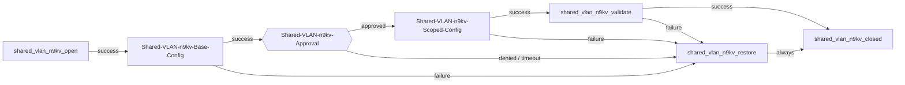

# Shared VLAN Lab — Nexus 9000v (NX-OS) variant

This folder is a self-contained **NX-OS** version of the shared VLAN lab in [`../`](../README.md)
(which runs on Catalyst 9000v). Same design, same workflow, same checks; the roles use
`cisco.nxos`, and every lab, port, group and AAP object name includes **n9kv** so both variants
can live on the same containerlab host and in the same AAP.

See the [main README](../README.md) for the full explanation of Private VLANs, VRF-Lite, the
reachability matrix and the ServiceNow summary.

> ⚠️ **Known limitation:** n9kv (tested on NX-OS 10.5(3)) accepts the full private-VLAN
> configuration, but its emulated data plane **doesn't forward private-VLAN traffic**
> (no MACs learned in VLANs 100–102, gateway ARP `INCOMPLETE`). Expect
> `shared_vlan_n9kv_validate` to fail **isolated → gateway** and **isolated → research-srv**, and
> the workflow to take the restore path every time. The automation (ticket, backups, config,
> approval, validation, `configure replace` rollback, ticket update) works end to end.
> Details: [main README, section 9](../README.md#9-platform-history-why-catalyst-9000v).

---

## Topology

```
 research-srv 10.30.30.10
      | eth1
 [Eth1/2 routed, VRF RESEARCH 10.30.30.1]
 n9kv1  core / promiscuous gateway        172.20.20.81   ssh container_lab:2232
   Vlan100 10.100.100.1/24  VRF RESEARCH  (private-vlan mapping 101-102)
   Vlan200 10.200.200.1/24  VRF GUEST
 Eth1/1
   ||  802.1Q trunk  allowed 100-102,200
 Eth1/1
 n9kv2  access                            172.20.20.82   ssh container_lab:2233
   Eth1/2  host1   10.100.100.11  PVLAN host 100/101  ISOLATED
   Eth1/3  host2   10.100.100.12  PVLAN host 100/101  ISOLATED
   Eth1/4  host3   10.100.100.13  PVLAN host 100/102  COMMUNITY
   Eth1/5  host4   10.100.100.14  PVLAN host 100/102  COMMUNITY
   Eth1/6  guest1  10.200.200.20  access VLAN 200     GUEST
```

| | cat9kv lab (`../`) | **n9kv lab (this folder)** |
|---|---|---|
| Topology file | `shared_vlan.clab.yml` | `shared_vlan_n9kv.clab.yml` |
| Lab / containers | `shared_vlan` / `clab-shared_vlan-*` | `shared_vlan_n9kv` / `clab-shared_vlan_n9kv-*` |
| Switches | cat9kv1, cat9kv2 | n9kv1, n9kv2 |
| Switch SSH ports | 2230, 2231 | **2232, 2233** |
| Mgmt IPs | 172.20.20.71–78 | **172.20.20.81–88** |
| Interfaces | GigabitEthernet1/0/N | Ethernet1/N |
| AAP group | `shared_vlan` | `shared_vlan_n9kv` |
| Backups | `shared_vlans/backups/` | `shared_vlans/shared_vlans_n9kv/backups/` |

Data-plane addressing is identical in both labs (they're separate containerlab networks).

---

## Files

```
shared_vlans_n9kv/
├── shared_vlan_n9kv.clab.yml    # containerlab topology (n9kv)
├── setup.yml                    # AAP controller-as-code (all names contain n9kv)
├── inventory.yml                # example CLI inventory
├── snow_open.yml                # open ServiceNow incident
├── base_config.yml              # git backup (pre-change) + nxos_base + demo failure injection
├── scoped_config.yml            # VLANs, trunk, PVLAN, VRF-Lite
├── validate.yml                 # endpoint ping matrix on the containerlab host
├── restore.yml                  # nxos_file_copy + configure replace from the base backup
├── snow_close.yml               # per-node summary, close or leave incident open
├── group_vars/shared_vlan_n9kv.yml
├── host_vars/n9kv1.yml, n9kv2.yml
├── backups/                     # <host>.cfg = rollback point, <host>_scoped.cfg = post-change
└── roles/
    ├── nxos_base/               # hostname, features, global lines, mgmt route, banner, interfaces
    ├── nxos_trunk/              # regular VLANs, 802.1Q trunks, access ports (nxos_config)
    ├── nxos_pvlan/              # PVLAN domain, host ports, promiscuous mapping
    ├── nxos_vrf_lite/           # vrf context, vrf member + IP, static routes
    ├── nxos_restore/            # copy backup to bootflash + configure replace
    ├── git_backup/              # back up running config, push to Gitea (master)
    └── shared_vlan_validate/    # docker exec ping checks with retries
```

---

## AAP

| Object | Name |
|---|---|
| Hosts (Workshop Inventory) | `n9kv1` (`'{{ container_lab }}'`:2232), `n9kv2` (:2233), `cisco.nxos.nxos` |
| Group | `shared_vlan_n9kv` |
| Credential | `Shared VLAN n9kv Credential` (Machine, admin / admin@123) + existing `Gitea Credential`, `snow_demo`, `azure` |
| Job templates | `shared_vlan_n9kv_open`, `Shared-VLAN-n9kv-Base-Config`, `Shared-VLAN-n9kv-Scoped-Config`, `shared_vlan_n9kv_validate`, `shared_vlan_n9kv_restore`, `shared_vlan_n9kv_closed` |
| Approval node | `Shared-VLAN-n9kv-Approval` |
| Workflow | `Shared-VLAN-n9kv-Workflow` (survey: `inject_failure` = `none` / `base_error`) |



All job templates use the `ee-validated-25` execution environment and the Student Project.
`shared_vlan_n9kv_validate` runs on `containerlab1` (inventory `containerlab`, credential `azure`).

ServiceNow incidents are titled **"Shared VLAN (n9kv) configuration started …"**, so the close step
never picks up an incident from the cat9kv workflow.

Setup (same loader as the other demos):

```bash
ansible-navigator run setup_demo.yml --eei registry.gitlab.com/redhatautomation/validated-network-ee:latest -m stdout \
  -e "demo=shared_vlans/shared_vlans_n9kv"
```

> ⚠️ Like the other demos, `setup.yml` sets the Student Project URL to `http://ansible-1:3000/...`;
> on an AAP where that doesn't resolve, running it through `setup_demo.yml` breaks project sync.

---

## Playbooks and roles (NX-OS specifics)

| Step | NX-OS implementation |
|---|---|
| Base | `feature interface-vlan`, `feature private-vlan`, `feature lldp`; default route in `vrf context management`; `nxos_interfaces` for L2/L3 mode. No license step (n9kv doesn't need one for VRF-Lite) |
| Trunk / access | `nxos_config` (`switchport mode trunk`, `switchport trunk allowed vlan`, `switchport access vlan`). Resource modules aren't used because they fail to parse PVLAN host ports on re-runs |
| PVLAN | `private-vlan isolated/community`, `private-vlan primary` + `association 101-102`, `switchport mode private-vlan host` + `host-association`, `private-vlan mapping 101-102` on Vlan100 |
| VRF-Lite | `vrf context X`, `vrf member X` then `ip address a.b.c.d/nn` (`replace: block`) |
| Restore | `feature scp-server`, `nxos_file_copy` to `bootflash:shared_vlan_restore.cfg`, `nxos_config replace: config` (`configure replace`), save |
| Demo failure | `inject_failure=base_error` → Base-Config pushes `vlan 5000` (out of range), fails → restore |

Validate, backups, ServiceNow open/close, approval and failure injection behave exactly as in the
cat9kv lab.

---

## Variables

| Variable | Where | Value |
|---|---|---|
| `ansible_network_os` | group_vars | `cisco.nxos.nxos` |
| `base_features` | group_vars | `interface-vlan`, `private-vlan`, `lldp` |
| `base_global_lines` | group_vars | `no ip domain-lookup` |
| `mgmt_gateway` | group_vars | `172.20.20.1` |
| `pvlan_secondary` / `pvlan_primary` | group_vars | 101 isolated, 102 community / 100 primary, association `101-102` |
| `vlans` | group_vars | `200 GUEST` |
| `trunk_ports` | host_vars | Ethernet1/1 allowed `100-102,200` (both) |
| `vrf_interfaces` | n9kv1 | Vlan100 10.100.100.1/24 RESEARCH · Vlan200 10.200.200.1/24 GUEST · Ethernet1/2 10.30.30.1/24 RESEARCH |
| `pvlan_svi_mappings` | n9kv1 | Vlan100 → `101-102` |
| `pvlan_host_ports` | n9kv2 | Ethernet1/2–1/3 → 100/101 · Ethernet1/4–1/5 → 100/102 |
| `access_ports` | n9kv2 | Ethernet1/6 VLAN 200 |
| `validate_lab_name` | validate.yml | `shared_vlan_n9kv` |
| `git_backup_dir` / `restore_dir` | role defaults | `shared_vlans/shared_vlans_n9kv/backups` |

---

## Deploy

```bash
# on the containerlab host; configs/n9kv1|2/startup.cfg must exist there and create
#   username admin password admin@123 role network-admin   (lab-only default password)
sudo containerlab deploy -t shared_vlan_n9kv.clab.yml
```

- `image: vrnetlab/cisco_n9kv:10.5.3` is a placeholder; set the n9kv image tag on your clab host.
- Links are contiguous per node (`eth1`, `eth2`, …) to avoid the vrnetlab NIC/PCI-slot bug seen with
  cat9kv.
- Both labs can run on the same containerlab host at the same time (ports, IPs and lab names don't
  overlap), as long as it has the CPU and memory for four switches.
